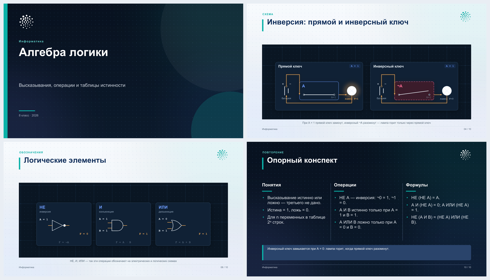
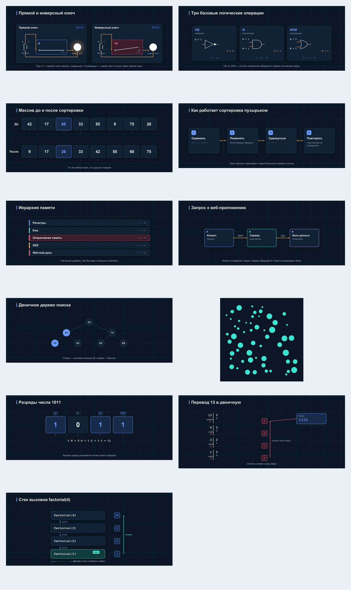

# Проект: учебные материалы — презентации и викторины

Репозиторий собирает презентации из одного YAML-файла в PPTX, PDF и HTML
и однофайловые викторины-сопоставления (`index.html`). Оформление (цвета,
шрифты, логотип) и стиль иллюстраций хранятся отдельно и применяются ко всем
презентациям. Слайды — светлые, с точечной сеткой и мягким свечением;
схемы — тёмные технические панели.



## Что где лежит

```text
.opencode/
├── agents/
│   ├── lesson-studio.md             # диспетчер (по умолчанию): что делаем и кому передать
│   ├── presentation-maker.md        # агент, который делает презентации
│   ├── lesson-game-builder.md       # агент викторин-сопоставлений (один index.html)
│   ├── metodist-vpr.md              # агент ВПР-тренажёров: оркестрирует сборку теста
│   └── vpr-субагенты/               # analitik-zadanij, razrabotchik-testa,
│                                    # kontroler-kachestva — вызывает metodist-vpr
├── commands/
│   ├── studio.md                    # /studio — запустить диспетчера
│   ├── presentation.md              # /presentation <тема> — <класс>
│   ├── game.md                      # /game <тема> — <класс>
│   └── vpr.md                       # /vpr <файл с заданиями>
└── skills/
    ├── presentation-brief/           # бриф: что спросить до старта
    ├── presentation-content/         # план, текст, факты по информатике
    ├── presentation-design/          # макеты, типографика, чек-лист
    ├── presentation-illustrations/   # схемы и картинки из YAML
    ├── presentation-examples/        # пошаговые иллюстрации к примерам
    ├── presentation-facts/           # проверка фактов, формул, дат и кода
    ├── presentation-standards/       # сверка с ФГОС и ФРП для класса
    ├── presentation-build/           # сборка, схема deck.yaml, совместимость
    ├── presentation-export/          # экспорт одного формата и приёмка файла
    ├── lesson-content-design/        # подбор пар «термин ↔ определение»
    ├── lesson-game-spec/             # контракт игры-сопоставления
    ├── touch-drag-engine/            # перетаскивание на Pointer Events
    ├── child-ui/                     # детский интерфейс игры
    ├── qa-verify/                    # проверка готовой игры
    ├── vpr-formaty/                  # типы заданий ВПР
    ├── test-html-shablon/            # движок теста и правила сборки
    ├── scoring-rezultaty/            # скрытые результаты и скоринг
    └── cheklist-testa/               # чек-лист готового теста
templates/default/
├── theme.yaml                        # цвета, шрифты, логотип, поля
├── illustrations.yaml                # тёмный стиль схем: сетка, свечение, палитра
├── base.pptx                         # генерируется из theme.yaml
└── assets/
    ├── logo.png, logo_dark.png       # логотип для светлых и тёмных слайдов
    └── bg-light.png, bg-dark.png     # фоны: точечная сетка и свечение
decks/
├── 01-algebra-logiki-8-klass/        # основной пример: алгебра логики, 10 слайдов
├── 02-algoritmy-sortirovki/          # второй пример: сортировки, 9 слайдов
├── 03-sistemy-schisleniya-7-klass/   # третий пример: системы счисления, 14 слайдов
└── 04-recursion-10-klass/            # четвёртый пример: рекурсия, 16 слайдов
scripts/
├── build.py                          # единая точка входа
├── model.py                          # чтение и проверка deck.yaml
├── theme.py                          # шаблон и шрифты
├── render_pptx.py
├── render_pdf.py
├── render_html.py
├── make_template.py                  # сборка base.pptx
├── illustrations.py                  # генератор схем и иллюстраций
├── check_frp.py                      # сверка презентации с ФРП
└── prepare_logo.py                   # подготовка логотипа
docs/
├── preview.png                       # превью презентации
├── standards/                        # ФРП 2025 (PDF), источник для сверки
└── illustrations/                    # галерея сцен и их YAML-описания
games/                                 # викторины-сопоставления: games/<slug>-<класс>/index.html
tests/                                 # ВПР-тесты: tests/*.html + examples/ (демо-движок)
Project3/                              # исходная папка агента ВПР (резервная копия)
v/                                     # резервная копия перенесённого агента игр
dist/                                  # результаты сборки (не коммитится)
```

## Бриф перед стартом

Первый вопрос агента:

> Хотите задать свои критерии и параметры или взять значения по умолчанию?

**По умолчанию:** PDF, объяснение на уроке, 12–15 слайдов, углублённый
уровень, без готовых материалов, Python, текущий modern-стиль. В этом режиме
агент спрашивает только тему и класс, если их нет.

**Свои параметры** — тогда уточняются:

1. Тема и фокус — что именно раскрыть.
2. Класс/курс и уровень.
3. Цель (урок, доклад, защита) и **один** формат: PPTX, PDF или HTML.
4. Объём: минуты или число слайдов.
5. Программа, материалы, оформление, заметки и практика.

Полный бриф — `.opencode/skills/presentation-brief/SKILL.md`.

## Быстрый старт

```bash
python3 -m pip install -r requirements.txt
python3 scripts/build.py decks/01-algebra-logiki-8-klass --formats pdf
```

Результат:

```text
dist/algebra-logiki-8-klass/algebra-logiki-8-klass.pdf
```

Один запуск — один формат. Остальные собираются отдельными запусками:

```bash
python3 scripts/build.py decks/01-algebra-logiki-8-klass --formats pptx
python3 scripts/build.py decks/01-algebra-logiki-8-klass --formats html
python3 scripts/build.py decks/01-algebra-logiki-8-klass --check

# сверка с федеральной рабочей программой
python3 scripts/check_frp.py decks/01-algebra-logiki-8-klass
```

Другие примеры:

```bash
python3 scripts/build.py decks/02-algoritmy-sortirovki --formats pdf
python3 scripts/build.py decks/03-sistemy-schisleniya-7-klass --formats pptx
python3 scripts/build.py decks/04-recursion-10-klass --formats pdf
```

## Новая презентация

1. Скопируйте папку примера:

   ```bash
   cp -R decks/01-algebra-logiki-8-klass decks/03-moya-tema
   ```

2. Откройте `decks/03-moya-tema/deck.yaml` и замените `meta` (название, автор,
   класс, форматы) и `slides`.
3. Соберите:

   ```bash
   python3 scripts/build.py decks/03-moya-tema
   ```

Полное описание полей — `.opencode/skills/presentation-build/references/deck-schema.md`.
Макеты — `.opencode/skills/presentation-design/references/layouts.md`.

## Иллюстрации

Схемы, массивы, деревья, процессы и логические элементы собираются из
YAML-описаний в стиле «миллиметровка + технические карточки».



```bash
# одна сцена
python3 scripts/illustrations.py decks/01-algebra-logiki-8-klass/assets/logic.yaml

# все сцены папки
python3 scripts/illustrations.py decks/01-algebra-logiki-8-klass/assets/*.yaml
```

Доступные типы: `logic`, `gates`, `array`, `radix`, `division`, `flow`,
`layers`, `schema`, `tree`, `dots`. Полные описания —
`.opencode/skills/presentation-illustrations/references/scenes.md`.
Примеры на картинках — в российской школьной записи: деление уголком,
десятичная запятая, пробел между разрядами.
Стиль (палитра, клетка, радиусы, тени) — `templates/default/illustrations.yaml`.
После правки стиля пересоберите картинки и презентацию.

Иллюстрация подключается в `deck.yaml` как обычная картинка:

```yaml
- layout: image
  title: "Инверсия: прямой и инверсный ключ"
  image: "assets/logic.png"
  caption: "При A = 1 инверсный ключ разомкнут"
```

## Структура презентации

- **Титул** — общая тема и уточнение, что именно разбирается: «Алгебра логики» +
  «Высказывания, операции и таблицы истинности». Класс и год, без фамилии
  и имени: презентацию показывает учитель.
- **Первый содержательный слайд** идёт сразу после титула. Отдельный
  слайд-раздел вторым не ставится.
- **Финал** — краткий опорный конспект (`summary`): ключевые понятия, формулы,
  правила. Слайда «Спасибо за внимание» нет.
- **Цитаты** — только по делу: слайд, на котором одна цитата, не ставится.
  Цитата подтверждает тезис или уходит в заметки.
- Титул и финальный конспект — тёмные, содержательные слайды — светлые.

## Оформление и логотип

Всё оформление — в `templates/default/theme.yaml`:

- `colors` — фирменные цвета (акцент совпадает с цветом логотипа `#0AB2A9`);
- на титуле — только класс и год, без ФИО;
- `fonts` — Arial и Courier New (совместимы с Р7/МойОфис/LibreOffice);
- `logo` — две версии: для светлых и тёмных слайдов;
- `margins` — поля слайда.

Логотип уже установлен: кластер бирюзовых точек. Чтобы заменить его:

```bash
python3 scripts/prepare_logo.py ~/Downloads/logo.png
```

Скрипт обрежет поля, сделает прозрачный фон и соберёт:

```text
templates/default/assets/logo.png        # цветная версия для светлых слайдов
templates/default/assets/logo_dark.png   # белая версия для тёмных слайдов
```

Размер задаётся в `logo.width` (дюймы).

После правки `theme.yaml`:

```bash
python3 scripts/build.py --refresh-template
```

## Форматы и совместимость

| Формат | Для чего |
| --- | --- |
| PPTX | правка в PowerPoint, Р7-Офисе, МойОфисе, LibreOffice |
| PDF | сдача и печать, одинаковый вид везде |
| HTML | показ в браузере, стрелки ← →, `N` — заметки, `F` — полный экран |

PPTX собирается только из базовых объектов (фигуры, текст, таблицы, PNG/JPG):
без SmartArt, SVG, 3D и анимаций. Поэтому он предсказуемо открывается во всех
офисных пакетах. PDF собирается напрямую, LibreOffice для него не нужен.

Один запуск `build.py` собирает ровно один формат: `--formats pdf`, `pptx` или
`html`. Если `meta.formats` не задан, по умолчанию собирается `pdf`. Формат
называет заказчик; собирать все три «на всякий случай» не нужно — подробности
в скилле `presentation-export`.

Тёмные слайды — титул и финал — остаются частью шаблона. Светлые слайды
содержат цветной логотип, тёмные — белую версию, поэтому знак виден везде.

## Соответствие программе

Проверка, что тема и термины соответствуют ФРП для класса:

```bash
python3 scripts/check_frp.py decks/01-algebra-logiki-8-klass
```

Скрипт печатает, какие темы ФРП раскрыты на слайдах, а какие относятся
к другому классу. Источники — `docs/standards/` (ФРП 2025, углублённый
уровень); выжимка и правила — скилл `presentation-standards`.

## Агенты и команды

В проекте три агента. По умолчанию включён диспетчер `lesson-studio`:
каждый новый сеанс начинается с вопроса «что делаем?».

| Агент | Что делает | Как запустить |
|---|---|---|
| `lesson-studio` | выясняет, что нужно (презентация / викторина / тренажёр к ВПР), собирает тему и класс, передаёт работу | по умолчанию или `/studio` |
| `presentation-maker` | презентации по информатике в PPTX, PDF и HTML | `/presentation <тема> — <класс>` |
| `lesson-game-builder` | викторина-сопоставление «термин ↔ определение», один `index.html` | `/game <тема> — <класс>` |
| `metodist-vpr` | интерактивный ВПР-тест из файла с заданиями: случайные 5 заданий, скрытые ответы, таймер | `/vpr <файл с заданиями>` |

`metodist-vpr` работает через трёх субагентов: `analitik-zadanij` (разбор
заданий), `razrabotchik-testa` (сборка HTML) и `kontroler-kachestva`
(проверка по чек-листу). Готовые тесты — в папке `tests/`.

Пример запроса диспетчеру:

> «Нужна презентация и викторина по теме “Системы счисления” для 8 класса»

Диспетчер покажет карточку заказа и даст две готовые команды:
`/presentation Системы счисления — 8` и `/game Системы счисления — 8`.

### Скиллы презентаций (`presentation-maker`)

- `presentation-brief` — первый шаг: бриф и приоритеты вопросов;
- `presentation-content` — структура, уровень, факты;
- `presentation-design` — макеты, типографика, проверка вёрстки;
- `presentation-illustrations` — генерация схем и иллюстраций;
- `presentation-examples` — пошаговые иллюстрации к примерам и алгоритмам;
- `presentation-facts` — проверка определений, формул, дат и кода;
- `presentation-standards` — сверка с ФГОС и ФРП для класса;
- `presentation-build` — сборка и совместимость форматов;
- `presentation-export` — экспорт ровно одного формата и приёмка файла.

### Скиллы викторин (`lesson-game-builder`)

- `lesson-content-design` — подбор 6 однозначных пар «термин ↔ определение»;
- `lesson-game-spec` — неизменяемый контракт игры, механики и счёта;
- `touch-drag-engine` — перетаскивание карточек на Pointer Events;
- `child-ui` — детский интерфейс: шрифт, палитра, адаптив;
- `qa-verify` — статическая проверка готового `index.html`.

### Скиллы ВПР-тренажёров (`metodist-vpr`)

- `vpr-formaty` — каталог типов заданий ВПР и их интерактивных элементов;
- `test-html-shablon` — эталонный движок теста и правила сборки;
- `scoring-rezultaty` — скрытие ответов до сдачи, баллы и итоговый экран;
- `cheklist-testa` — чек-лист проверки готового теста.

## Требования

- Python 3.10+
- `python-pptx`, `PyYAML`, `reportlab`, `Pillow`

LibreOffice, Node.js и PowerPoint для сборки не требуются.

## Частые проблемы

Смотрите `.opencode/skills/presentation-build/references/troubleshooting.md`.
Коротко:

- нет модуля `pptx` → `python3 -m pip install -r requirements.txt`;
- не найден шрифт для PDF → установите Arial/Liberation Sans/DejaVu Sans;
- не виден логотип → проверьте обе версии в `templates/default/assets/`;
- изменили цвета, но ничего не поменялось → `--refresh-template`;
- картинка не пересобралась → запустите `scripts/illustrations.py` для её YAML.
